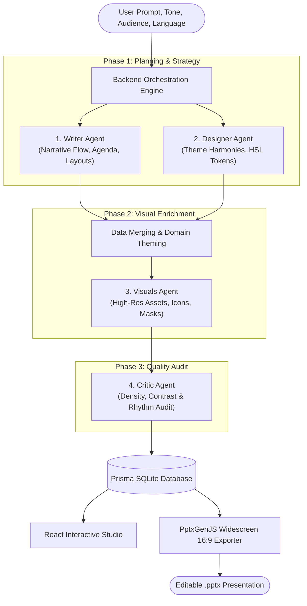

<div align="center">

  

  # 🚀 Slidewright AI
  ### Autonomous Multi-Agent Executive Presentation Studio & Native 16:9 PPTX Engine

  <p align="center">
    <b>Transform raw prompts, research papers, and business strategies into McKinsey-grade, pixel-perfect executive presentations in seconds.</b>
  </p>

  <p align="center">
    <a href="https://github.com/sohail-ahmed-26/slidewright">
      
    </a>
    <a href="https://sohail.devsil.com" target="_blank">
      
    </a>
    <a href="https://www.linkedin.com/in/sohail-ahmed-devsil" target="_blank">
      
    </a>
    <a href="mailto:sohail.bsrh@gmail.com">
      
    </a>
  </p>

  <p align="center">
    
    
    
    
    
    
    
    
    
  </p>

</div>

---

## 📸 Visual Showcase & App Interface

<div align="center">
  <h3>🖥️ Executive Canvas & Real-Time Slide Studio</h3>
  
  <p><em>Interactive 16:9 high-resolution slide editor with dynamic canvas scaling, live speaker notes, and instant layout switching.</em></p>
</div>

<br/>

<table width="100%">
  <tr>
    <td width="50%">
      <div align="center">
        <h4>⚡ Generation Studio</h4>
        
        <p><em>Audience, Tone, Slide Count & Topic Prompting</em></p>
      </div>
    </td>
    <td width="50%">
      <div align="center">
        <h4>📂 Slide Presentation Library</h4>
        
        <p><em>Manage, duplicate, rename, preview, and download PPTX decks</em></p>
      </div>
    </td>
  </tr>
  <tr>
    <td width="50%">
      <div align="center">
        <h4>🤖 Multi-Agent Orchestration Hub</h4>
        
        <p><em>Pipeline status across Orchestrator, Writer, Designer, Visuals, Critic & Export</em></p>
      </div>
    </td>
    <td width="50%">
      <div align="center">
        <h4>⚙️ AI Agent Prompt & Schema Customizer</h4>
        
        <p><em>Inspect, edit, and permanently persist custom agent system prompts & Zod schemas</em></p>
      </div>
    </td>
  </tr>
  <tr>
    <td width="50%">
      <div align="center">
        <h4>📊 Executive Content & Layout Density</h4>
        
        <p><em>Well-structured multi-column cards, clear typography, and strong contrast</em></p>
      </div>
    </td>
    <td width="50%">
      <div align="center">
        <h4>🛠️ Engine Settings & Provider Config</h4>
        
        <p><em>OpenRouter model selection, mock testing mode, and storage management</em></p>
      </div>
    </td>
  </tr>
</table>

---

## 🌟 What is Slidewright?

**Slidewright** is an end-to-end, multi-agent AI presentation engine designed to solve the fundamental flaw of AI presentation tools: **boring, illegible, unstructured, low-contrast slides**.

Unlike generic tools that dump bullets onto repetitive backgrounds, Slidewright coordinates **four specialized AI agents** that work together in a structured pipeline. It enforces executive storytelling standards (Cover $\rightarrow$ Agenda Roadmap $\rightarrow$ Conceptual Deep-Dives $\rightarrow$ Quantified Impact $\rightarrow$ Strategic Takeaways), derives dynamic domain-specific color themes, and exports cleanly into standard PowerPoint widescreen PPTX files.

### 🎯 Key Highlights

* **🧠 Multi-Agent Collaborative Pipeline:** 4 dedicated AI specialists (Writer, Designer, Visuals, Critic) orchestrated sequentially with automated recovery and refinement loops.
* **🗺️ Executive Storytelling Flow:** Guarantees proper narrative structure: Slide 1 (Cover + Topic Visual), Slide 2 (Executive Agenda & Roadmap), Slides 3..N-2 (Deep-dive layouts), Slide N-1 (Quantified Metrics), Slide N (Closing & Takeaways).
* **🎨 Domain-Aware Dynamic Color & Theming Engine:** Never uses the same monotonous theme. Detects the domain (Healthcare, Finance, Tech, Education, Energy, Marketing) and dynamically applies tailored palettes, card tints, and typography.
* **📊 Widescreen 16:9 Native PPTX Engine:** Exports directly into standard Microsoft PowerPoint (`13.333" x 7.500"`) with safe coordinate bounds, vector cards, and high-DPI imagery—**zero edge bleeding, zero text truncation**.
* **🌓 High-Contrast Clean Visual Hierarchy:** Content slides render with clean white/subtle-tinted backgrounds, dark charcoal headings, colored keyword accents, and high-contrast body text. Dark backgrounds are reserved for hero covers and metric spotlights.
* **🌐 Multilingual & Multi-Tone Intelligence:** Fully supports native prompt generation across languages including English, Urdu (اردو), Spanish, Arabic, French, German, and Chinese with executive, academic, persuasive, or conversational tones.
* **🛠️ Full-Featured Web Studio:** Interactive canvas with live scale-to-fit ResizeObserver, speaker notes editor, layout switching, slide thumbnail navigator, and presentation mode.

---

## 🏗️ Architecture & Multi-Agent Workflow



### The 4 Specialized AI Agents

| Agent | Role | Responsibilities | Output Schema |
| :--- | :--- | :--- | :--- |
| **✍️ Writer** | Subject-Matter Analyst & Storyteller | Establishes slide count, enforces slide sequence (Cover $\rightarrow$ Agenda $\rightarrow$ Body $\rightarrow$ Metrics $\rightarrow$ Closing), crafts multi-sentence executive takeaways. | `WriterOutputSchema` |
| **🎨 Designer** | Visual Director & Design Systems | Selects harmonic HSL hues, typography pairings (Inter, Calibri, Outfit), card styles, and motif aesthetics. | `DesignerOutputSchema` |
| **🖼️ Visuals** | Image Prompt & Icon Engineer | Assigns high-resolution topic visuals, Gamma-style image masks, and contextual Lucide vector icons. | `VisualsOutputSchema` |
| **⚖️ Critic** | Quality Auditor & Layout Reviewer | Evaluates layout slot density, dark/light rhythm, and textual readability. Suggests automated fixes. | `CriticOutputSchema` |

---

## 🎨 Domain-Aware Dynamic Color Theming Engine

Slidewright dynamically derives tailored color palettes based on the semantic topic of the presentation:

| Topic Domain | Theme Mood | Primary | Secondary | Background (Cover / Content) | Card Tint |
| :--- | :--- | :---: | :---: | :--- | :--- |
| **Healthcare & Clinical** | Clinical Precision | `#0C7C79` | `#16B7B3` | `#0E3A3B` / `#FFFFFF` | `#F1FAFA` *(Clinical Mint)* |
| **Finance & Investment** | Executive Wealth | `#047857` | `#D97706` | `#064E3B` / `#FFFFFF` | `#F9FAFB` *(Subtle Slate)* |
| **AI, Tech & Data Science**| Modern Intelligence | `#2563EB` | `#06B6D4` | `#070F26` / `#FFFFFF` | `#F8FAFC` *(Electric Tint)* |
| **Education & Careers** | Academic Innovation| `#4F46E5` | `#F43F5E` | `#1E1B4B` / `#FFFFFF` | `#EEF2FF` *(Academic Lavender)*|
| **Energy & Climate** | Sustainable Future | `#15803D` | `#CA8A04` | `#052E16` / `#FFFFFF` | `#F0FDF4` *(Eco Forest)* |
| **Marketing & Creative** | Creative Momentum | `#7C3AED` | `#DB2777` | `#2E1065` / `#FFFFFF` | `#FAF5FF` *(Plum Accent)* |
| **Corporate Executive** | Strategic Navy | `#1E3A8A` | `#0284C7` | `#0B132B` / `#FFFFFF` | `#F8FAFC` *(Corporate Slate)* |

---

## 📐 Catalog of Supported Slide Layouts

Slidewright features an extensive library of specialized, responsive slide layouts:

1. **`cover`** — Executive hero layout with split angular visual mask, presenter credentials, and badge.
2. **`agenda`** — Executive roadmap spanning 3–4 numbered pillars (`01` to `04`) establishing presentation structure.
3. **`process_steps`** — Numbered workflow cards stretching 100% across the slide with zero blank gaps.
4. **`comparison`** — High-contrast dual comparison (Option A vs. Option B) with check and cross indicators.
5. **`two_cards`** — Side-by-side strategic pillar deep dives.
6. **`cards_3_bar`** — Three-column horizontal capability breakdown.
7. **`grid_2x2`** — Four-quadrant matrix with iconography and detailed descriptive bodies.
8. **`big_number_dark`** — High-impact KPI hero callout with supporting context cards.
9. **`stats`** — Three-metric executive dashboard with animated count-up numbers.
10. **`timeline`** — Chronological roadmap with milestones and milestone dates.
11. **`icon_rows`** — Vertical capability list with circular icon badges.
12. **`image_split`** — Conceptual topic imagery paired with structured explanatory text.
13. **`diagram`** — Architecture flowchart and workflow visualization.
14. **`quote`** — Executive testimonial and leadership quotation.
15. **`closing`** — Strategic conclusion slide with action plan and contact info.

---

## 🖥️ PPTX Native Export Engine (Widescreen 16:9)

Slidewright produces true native PowerPoint presentations powered by `PptxGenJS`:

* **Exact 16:9 Dimensions:** Configured to `13.333" x 7.500"` (matching modern Office 365 / Keynote widescreen defaults).
* **Safe Coordinate Bounding:**
  * Left Margin: `0.80"` | Right Margin: `0.80"`
  * Content Width: `11.733"` (Cards dynamically stretch to divide space evenly).
  * Safe Bottom Bounding: Header, content, and footer lines never exceed `6.85"`.
* **Native Vector Primitives:** Rectangles, rounded cards, lines, badges, and fonts remain fully editable in Microsoft PowerPoint.

---

## 📁 Project Structure

```bash
slidewright/
├── agents/                  # AI Intelligence & System Prompts
│   ├── writer/              # Topic analysis, narrative structure & agenda
│   ├── designer/            # HSL palettes, font pairings & design tokens
│   ├── visuals/             # Topic imagery, masks & iconography
│   ├── critic/              # Quality scoring, rhythm & density review
│   └── llm/                 # Unified OpenRouter LLM client with retries
├── backend/                 # Node.js / Express Server
│   ├── src/
│   │   ├── api/             # RESTful API routes & Server-Sent Events (SSE)
│   │   ├── orchestrator/    # Sequential pipeline execution engine
│   │   ├── export/          # Widescreen 16:9 PptxGenJS export engine
│   │   └── db/              # Prisma SQLite database models & client
├── frontend/                # React 18 + Vite + Tailwind CSS App
│   ├── src/
│   │   ├── components/slide/# SlideCanvas, SlideLayouts, SlideComponents
│   │   ├── pages/           # DeckEditor, NewDeck, Library, Agents, RunJob
│   │   ├── store/           # Zustand reactive state stores
│   │   └── lib/             # API client & utility functions
├── shared/                  # Universal Shared TypeScript Package
│   ├── src/
│   │   ├── catalog.ts       # Layout specifications & slot constraints
│   │   ├── design/palette.ts# TopicTheme engine & contrast calculations
│   │   ├── images.ts        # Gamma-style curated visual engine
│   │   └── schemas/         # Zod schemas for all agent inputs/outputs
└── outputs/                 # Output artifact directory
    ├── decks/               # Generated deck JSON data
    ├── pptx/                # Generated native .pptx files
    └── screenshots/         # Application showcase screenshots
```

---

## 🚀 Quick Start & Installation

### Prerequisites
* **Node.js** v18+ or v20+
* **npm** or **pnpm**
* **OpenRouter API Key** (or enable mock mode for local testing)

### Step 1: Clone Repository
```bash
git clone https://github.com/sohail-ahmed-26/slidewright.git
cd slidewright
```

### Step 2: Environment Configuration
Create a `.env` file in the root directory:
```bash
cp .env.example .env
```
Add your credentials in `.env`:
```env
OPENROUTER_API_KEY=your_openrouter_api_key_here
MODEL_TEXT=openai/gpt-4o-mini
PORT=4000
VITE_API_URL=http://localhost:4000
```

### Step 3: Install Dependencies & Initialize Database
```bash
npm install
npm run db:push
```

### Step 4: Run Development Server
```bash
npm run dev
```

* **Frontend:** [http://localhost:5173](http://localhost:5173)
* **Backend API:** [http://localhost:4000](http://localhost:4000)

---

## 👨‍💻 About the Author

<div align="center">
  <a href="https://github.com/sohail-ahmed-26">
    
  </a>

  <h3>Sohail Ahmed</h3>
  <p><b>AI Engineer & Data Scientist | Full Stack AI Developer</b></p>
  <p><em>"Building intelligent AI systems that solve real-world problems through data, automation, and innovation."</em></p>

  <p>
    <a href="https://sohail.devsil.com" target="_blank">
      
    </a>
    <a href="https://www.linkedin.com/in/sohail-ahmed-devsil" target="_blank">
      
    </a>
    <a href="https://github.com/sohail-ahmed-26" target="_blank">
      
    </a>
    <a href="mailto:sohail.bsrh@gmail.com">
      
    </a>
    <a href="https://www.kaggle.com/sohail2411126" target="_blank">
      
    </a>
    <a href="https://x.com/ahmed241126" target="_blank">
      
    </a>
  </p>

  <p>
    📍 <b>Location:</b> Mansehra, Pakistan<br/>
    🏢 <b>Company:</b> Devsil (SMC-Private) Limited (<a href="https://devsil.com">@devsil.com</a>)<br/>
    💼 <b>Specialties:</b> Autonomous AI Agents, LLM Fine-Tuning, RAG Pipelines, Computer Vision & Full-Stack Systems
  </p>

</div>

---

## 📜 License

This project is developed and maintained by [Sohail Ahmed](https://github.com/sohail-ahmed-26) at **Devsil (SMC-Private) Limited**. All rights reserved.
